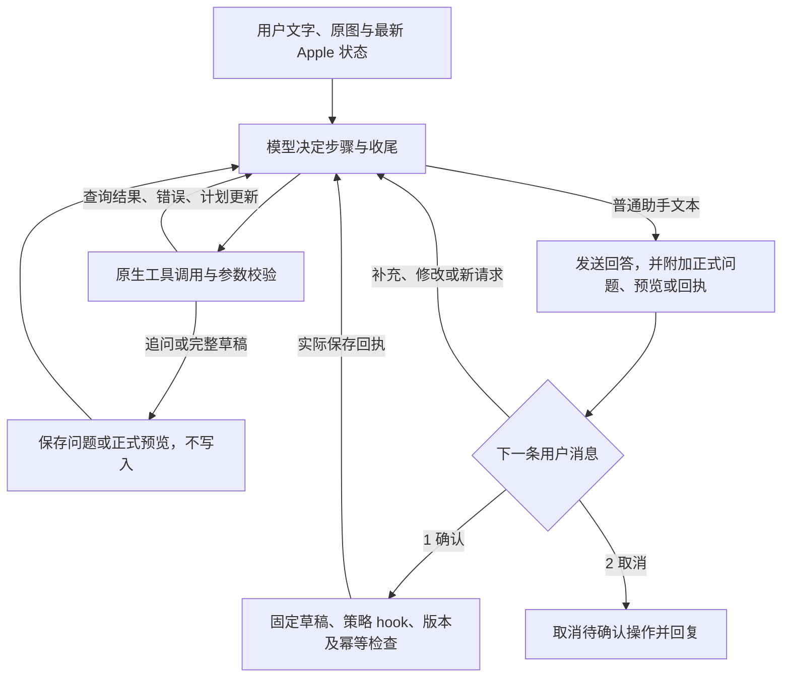

# 个人 Apple 工具

操作草稿是模型提交的结构化参数，可以包含已知字段与尚未明确的信息。`personalPlan` 是个人版的 Apple 操作工具；`AppleService` 独立于 Agent loop，Apple 为事实源，`cache.sqlite` 保存核对快照、错误与写入账本。`options.list_ids / calendar_ids` 控制后台核对和所有读写的共同范围，空数组表示全部。

| action | 行为 |
| --- | --- |
| query / detail | 读取事项、清单、群组、版本、归属、外观和原生能力；query 支持分页 |
| create / update / delete | 提交部分草稿；程序检查字段，完整后复用原有 Apple ToolExecution |
| revise | 用 draft_call_id 引用本会话已有草稿，只提交修改字段；未修改字段由程序保留，类型切换清除不兼容字段 |
| batch | 多项独立草稿共用一次预览，按顺序保存；失败后停止并报告完成数量 |



`interaction.py` 接收草稿并复用 `tools.py` 的五种执行对象；没有内部审批或授权旁路。配置为 `custom`、`personalPlan.approval: null`：查询和追问的 `need_confirm=False`，实际写入的 `need_confirm=True`，均经过 `agent/hooks/policy`。批量执行在全部草稿完整后展示合并预览，任一项缺少字段时不会先保存其它项；批量保存不承诺事务。目标重名和日期语义不明仍由 LLM 标记，程序负责确定性的字段检查，不能证明模型理解正确。

`personal_step` 更新上下文，不限制单次命名工具调用或提前结束。微信与终端统一由 apps/personal_runtime.py 处理；QuestionChannel 返回 awaiting_input，审批通道返回 deferred，强制 hook 不执行写入。结果均回到循环，由模型继续独立需求并返回普通文本；程序附加问题、预览及真实确认回执。等待状态沿用 personal_tasks.sqlite，下一条消息继续。

个人微信收到授权消息后先写入入站账本，再接入当前任务；图片下载在可取消的任务内进行，不阻塞收件。任何新文字或图片都会使未写入的旧执行失效，合并未完成输入并重新执行；版本检查覆盖工具解析、追问、审批与发送，取消后晚到的结果不能产生副作用。追问或预览结束后，下一条消息携带保存的任务数据启动新轮。确认通过固定草稿重放进入同一个 policy hook；执行前不请求 LLM 改写草稿，不生成第二份确认，写入身份沿用原来的 turn_id/tool_call_id。开始保存后新输入暂存，先等原生保存和核实结果，之后才继续。

例如 system 使用 `profiles/personal_system_prompt.md`，按需调用工具并用普通文本总结；user 内容为：

```text
time: 2026-10-11T10:00:00
content: 帮我增加个日程，今晚8-9点测试活动
```

程序同时注入真实可写日历的本轮快照。模型提交：

```json
{"action":"create","kind":"event","fields":{"title":"测试活动","start":"2026-10-11T20:00:00+08:00","end":"2026-10-11T21:00:00+08:00"}}
```

未指定目标时，程序优先选择唯一可写的「Telos-日程」，否则选择唯一可写日程日历；不能唯一确定时追问目标。正式预览显示目标名称和「2026年10月11日 20:00」等北京时间，参数仍为 ISO 8601。若工具参数未提供结束时间，仍返回 incomplete_draft 及字段约束；新建非全天日程的开始时间明确、但用户未给结束时间或时长时，模型按事项内容和上下文估算时长并补齐草稿，在预览外简短说明估算，交由用户确认或修改，不为时长单独追问。用户明确给出的时间优先，修改已有日程不重新估算替换已有时长；其他必要信息缺失时仍按需追问。地点和备注不必填写。

多模态请求由 Provider 将归档图片转换为 `image_url`，与本条文字一起提交。system 使用完整个人提示词，其中明确要求从当前原图提取已有字段；user 消息同时携带当前指令、状态和图片。例如截图中是虚构测试会议，2027年2月19日 14:35–16:10，接口内容示意如下（省略完整提示词、快照和 base64 数据）：

```json
[
  {"role":"system","content":"按需调用工具并用普通文本总结。直接读取当前原图的标题、日期和起止时间，已有字段不再追问；提前出发使用 alarm_minutes_before，保留活动起止时间。"},
  {"role":"user","content":[
    {"type":"text","text":"<system_reminder>\n<external_state_reminder>\n当前 Apple 快照\n</external_state_reminder>\n</system_reminder>\n\n<message from=\"user\" time=\"2027-02-18T10:00:00\">帮我增加个日程，提前40分钟出发</message>"},
    {"type":"image_url","image_url":{"url":"data:image/jpeg;base64,…"}}
  ]}
]
```

完整草稿为 `action=create`、`kind=event`，`fields` 包含标题、`start=2027-02-19T14:35:00+08:00`、`end=2027-02-19T16:10:00+08:00` 和 `alarm_minutes_before=[40]`。预览同时显示活动及 13:55 提醒，批准一次后交由 EventKit 随日程保存。该字段只适用于日程，类型为不重复的分钟数数组，每项范围 0 到 525600；设置数组替换该日程原有提醒，`[]` 清除，未提交则保留。`[20160,10080]` 表示提前14天和7天。Exchange 只允许一个提醒，其它账户写入后重新读取验证，服务截断提醒时报告未知写入，不能自动重复创建。提醒事项通过 `early_reminder_minutes` 设置一个提前提醒，`null` 清除；到期通知保留。原生 `PersonalReminderAlerts` 隔离 ReminderKit 的 dueDateDeltaAlert，以一个 REMSaveRequest 保存事项字段和提前提醒；整日间隔按当地日历日计算。日期已知但时刻缺失时仅追问时刻。原生查询返回提醒完整状态并纳入版本检查，Apple 中并发修改任何提醒都使旧预览失效。

创建容器时固定预览的账户，移动清单时固定目标群组基线。修改、删除均在批准后核对版本，由 Swift helper 保存前再次比较。清单名称、颜色使用 EventKit；群组、图标使用既有 ReminderKit 接口，混合修改可能部分成功。

版本计算与原生保存前比较均保留完整对象状态，仅排除顶层 `section_read_error` 诊断文字；该文字可能包含每次请求不同的 NSError 内存地址，不表示事项被修改。查询和详情继续返回该诊断，`section_id` 的未知值、真实分区归属、修改时间及其他字段仍参与冲突检查。分区读取失败时不将未知归属解释为空分区，相关筛选和移动继续按不可用处理。

操作编号由会话、轮次和工具调用编号共同生成；批量使用固定的子调用编号。重放返回原结果。结果未知时保留 pending 并暂停新写入，查询保持可用，不自动重复创建。

用户说明见 `docs/user/personal-agent.md`，测试说明见 `docs/development/personal-apple-testing.md`。

提醒事项要求多个提前提醒时，模型保留当前部分草稿并提交 `unresolved=[early_reminder]`，程序返回事项的「到期提醒＋1次提前提醒」约束。模型用 ask_user 说明限制和日程多提醒能力，再询问保留哪个时间。选择前不审批、不写入，不自行改变对象类型或拆分事项。

草稿修改使用 `revise`，从 `conversation.sqlite` 的工具记录恢复完整参数；`personal_tasks.sqlite` 只管理当前任务与输入交接，保存等待问题/预览供下一轮使用。跨会话引用、循环引用、已保存草稿重建均被拒绝。当前轮内最新草稿由 `context.py` 投影；跨轮由 `personal_task` 提醒传入。示例：system 提醒包含 `draft_call_id=initial`、标题“测试评审”、到期日 2026-11-18；user 的下一条输入为“保留为日程，17日全天，提前7天、14天”。模型提交 `{"action":"revise","draft_call_id":"initial","kind":"event","fields":{"start":"2026-11-17T00:00:00+08:00","end":"2026-11-17T23:59:59+08:00","all_day":true,"alarm_minutes_before":[10080,20160]}}`，程序保留标题并重新选择真实日历。

图片与文字使用相同调度规则；仅按收件身份去重，不根据图像内容跳过用户输入。未知写入在生成下一份写入草稿之前拦截，query/detail 仍可核实，普通 ask_user 仍可询问信息；崩溃恢复只读账本和最新 Apple，不自动清除未知记录或重复保存。微信字段追问不显示 Markdown 星号或问题 ID。

EventKit 日程先设置日期和全天属性，最后赋显式 alarms，避免切换全天时重写已设置的提醒；保存后继续逐项读回核对，不降低校验标准。

普通 `ask_user` 只返回问题、答案、时间和缺失信息，不返回 `draft` / `draft_call_id`。只有部分写入草稿可以被 `revise` 引用；已保存对象始终通过 query/detail 读取最新版本后使用 update。system 明确区分这两种后续路径；例如 user 回答“11月17日，提前7天与14天的那两天早上9点”，应读取原日程并 update，不引用普通追问，也不重新创建。

日程提醒可用相对分钟数表达不同日期的指定时刻。system 和工具字段说明给出换算示例：2026-11-17 全天的 start 为 00:00，user 要求提前14天与7天各上午9点时，使用 `alarm_minutes_before=[19620,9540]`，预览显示 2026-11-03 09:00、2026-11-10 09:00；原日程起止时间不变。

模型根据本轮 Apple 数据和工具结果回答，数据包含范围、过滤、分页和省略字段，不足时自行补查。清单只校验格式。执行前参数错误返回循环，由模型纠正，失败草稿不锁定字段；revise 仍合并未修改字段。整体受循环步骤上限约束，确认和写入账本保持独立。

个人计划只保存 content/status 的完整列表，工具操作不携带任务编号。模型自行判断计划进度与回复完整性；参数、固定草稿确认及操作账本是独立的执行检查。

## 提醒事项标签（开发中）

`fields.tags` 仅适用于提醒事项，是不带 `#`、不含空白、不重复的标签名称数组。创建时可直接设置；修改时替换完整列表，`[]` 清空，省略保留。追加标签须先 `query/detail` 读取当前 `tags` 再合并。日程、清单、群组拒绝该字段，标题或备注中的 `#文字` 不算原生标签。

标签读取纳入事项快照和 revision；预览显示目标标签，确认前外部修改标签会使旧预览失效。复用 ReminderKit 的 `hashtagContext`、`removeAllHashtags` 和 `addHashtagWithType:name:`，与旗标、提前提醒共用保存请求；保存后重新读取核对，结果不一致按未知写入处理。没有独立标签数据库或新增状态机。此改动尚未包含在已发布的 0.4.12 安装包中。

## 扩展功能（未发布）

- `reminder.parent_id` 管理同清单的一层子任务；`subtask_ids` 只读。拒绝循环、多层嵌套和直接删除含子任务的父任务。
- `kind=section` 管理清单内分区，创建需 `calendar_id`；`reminder.section_id` 移入/移出。读取全部成员（含已完成），只删除空分区。
- `reminder.attachments` 是完整图片/网页列表；使用 `file_path`/`url` 新增、`id` 保留已有，`[]` 清空。确认后检查图片摘要；未列入的附件会被移除。
- `reminder.urgent` 设置原生紧急状态；开启需明确到期时刻。
- `recurrence.ordinal_weekdays=[{day:"mon",week:2}]` 表示每月/年第二个周一；负序号从月底倒数。
- `kind=event_calendar` 创建、改名、改色及删除日历；删除预览说明整个日历（含窗口外日程）都会删除。
- `event.travel_time_minutes` 设置出行时长，0清除；`attendees/availability/event_status` 读取已有日程元数据，不提供会议邀请写入。
- 查询可组合容器、父任务、分区、标签、旗标、紧急、优先级和到期范围，筛选后分页。分区读取失败返回未知，不能当作空值或完整筛选结果。

原生实现复用旧 ReminderKit 的分区、成员关系、附件、紧急状态 selector，并使用当前 `ListSectionsInvocation` 的 property-list 协议读取分区模型。仅使用请求内临时缓存，保存后失效；没有新增持久化数据源或状态机。写入仍经原有 `ToolExecution` 审批与回执，目标父任务/分区也在确认后复核。私有接口在其他 macOS 上可能不同，不支持时明确报错。
