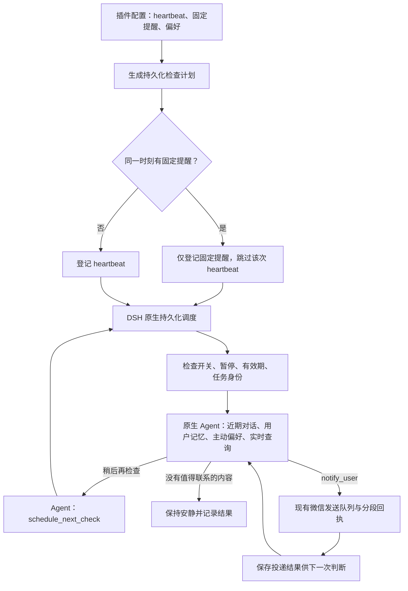

# 主动消息（开发分支）

Telos 复用 DSH 原生 Agent、会话历史、用户记忆和定时任务。这个功能只增加主动联系配置、检查记录和显式通知工具，不运行第二套模型循环。

## 使用与默认值

在插件「主动消息」中选择已经聊过的微信会话，开启总开关后保存并应用。升级后默认关闭总开关，避免自动向未选择的会话发消息。

- heartbeat 默认每 30 分钟检查一次，时间段为 08:00–次日 01:00，时区 Asia/Shanghai。开始时刻包含、结束时刻不包含；开始和结束相同表示全天。间隔从每日开始时刻对齐，而不是从进程启动时刻计时。
- 固定提醒预置 00:00、08:00、12:00、18:00，各自默认关闭；可修改时间、星期和 prompt，添加或删除提醒。
- 00:00 默认回顾前一天并收尾；08:00 查询睡眠、日历与待办，给一条建议；12:00 梳理下午优先级；18:00 回顾白天、提示晚间安排。没有接入睡眠数据源时必须说明数据缺失，不能编造。
- heartbeat 和后续检查允许保持安静；不再要求每天十次随机消息，也没有每小时补发。固定提醒的 prompt 要求 Agent 调用通知工具；若模型未调用，记录失败，不把内部回答自动转发。
- 同一计划时间、同一会话的启用固定提醒覆盖 heartbeat。判断依据是计划时间，不依赖定时器回调顺序。不合并相近的检查；后续检查与固定提醒同时到期时仍各自执行。
- 「暂停主动消息」覆盖 heartbeat、固定提醒与后续检查，不停止普通聊天或普通 `schedule_create` 任务。支持在微信请求暂停到带时区的指定时间。暂停期间到期的检查取消；恢复从下一时刻继续，不补发被取消的检查。
- 查看待执行和近期结果；后续检查可单独取消。修改主动消息配置会作废旧计划及旧的后续检查。只改人设、模型等其他配置不会重建主动消息计划。

## 工具与上下文

`notify_user({message})` 只能在真实主动检查轮次内调用。会话和检查 ID 由宿主绑定，不允许模型指定收件人。每次检查最多接受一条内容；长消息仍按微信长度限制分段。工具返回 `queued` 只表示入队，实际送达状态来自发送回执。普通后台总结永远不转发，重放完成事件时也一样。

`schedule_next_check({at, reason})` 接收带时区的未来绝对时间和完整检查原因，返回检查 ID。每次调用登记一个独立的持久化检查，不覆盖其他后续检查。相同工具调用 ID 重试返回原记录。原因到期时作为检查 prompt，届时重新读取上下文，而不是预先生成待发消息。此工具不会施加最小时间间隔，也不改变基础 heartbeat 节奏。后续检查和固定提醒可以在 heartbeat 活跃时间段之外运行；Agent 应遵守主动联系偏好中的休息要求。

`proactive_control({action, until?, event_id?})` 支持 list、pause、resume、cancel，仅在人类输入轮次使用。插件页面通过相同业务存储执行这些操作。

每次主动检查注入：检查种类、原计划时间、当前时间、时区、该次 prompt、主动联系偏好、最近检查和投递记录。DSH 继续加载当前会话及 `user.md`，必要时 Agent 使用当前会话历史、Apple、地图与网页查询工具。主动检查限制为只读查询及上述通知/登记工具，不自动执行 Apple 写入、终端或文件修改。用户消息优先，后台输入不能充当人类确认。

## 持久化与恢复

- `proactive.py`：配置校验、计划、暂停、检查身份与生命周期，记录在现有 `business.sqlite`。按未来 26 小时滚动生成固定提醒和 heartbeat；JS 每 30 秒补齐原生任务，这个维护过程不调用模型。
- `plugin/proactive.mjs`：原生调度入口校验、工具、上下文注入。任务 prompt 中只携带内部事件 ID；实际检查原因从业务存储读取。原生创建成功但本地绑定未保存时，从原生任务目录恢复绑定。
- `proactive_channel.py`：本机已认证接口、显式通知入队和静默结束。复用已有当前微信账号/会话校验。
- `scheduled_delivery.py`、`text_delivery.py`：发送前再次检查暂停、配置版本和有效期；保存稳定分段 ID 及回执。已确认片段不重发，明确拒收可重试；超时、取消或崩溃造成发送结果未知时保留记录并停止自动重放。

检查在原计划时刻后 30 分钟过期，避免恢复运行后补发过时的问候。重启可恢复有效期内已登记的任务；从未运行的时间段不追溯补建。DSH 或 Mac 关闭、休眠、断网，以及模型响应耗时，都可能导致延迟。界面显示计划时间，不承诺消息在整点送达。

夏令时按真实时间分钟生成：跳过不存在的本地时间，秋季重复的本地时间分别执行。固定提醒和 heartbeat 在每个真实时间点分别判定冲突。

## 验证

`tests/test_proactive.py` 覆盖时间冲突、关闭固定提醒、跨午夜、时区/夏令时、重复登记、暂停/恢复、会话隔离、过期、真实 DSH 工具调用、静默输出、只读边界、通知回执、重启恢复及相近检查分开执行。模型、Apple 和微信均为本机模拟服务。

`tests/desktop_client.test.mjs` 覆盖插件配置字段、固定提醒 prompt、保存及暂停/取消请求。`tests/test_proactive_hosts.py` 使用编译安装包和隔离 CLI/Desktop 配置，验证保存、运行中控制和通知恢复，不改用户现用安装。

本分支验证：85 项 Python 策略/集成/回归测试与 12 项前端测试通过，包括编译包在隔离 CLI/Desktop 宿主中的配置、暂停/恢复、通知和重启。开发包为 `0.4.20-proactive.1`，未发布、未替换用户现用安装。回归时在原始 main（`8085a95`）复现了一条旧预览文案断言失败，已调整为接受两种合法的拒绝确认提示，同时保留未送达前零写入、后续明确确认仅写入一次的断言。
