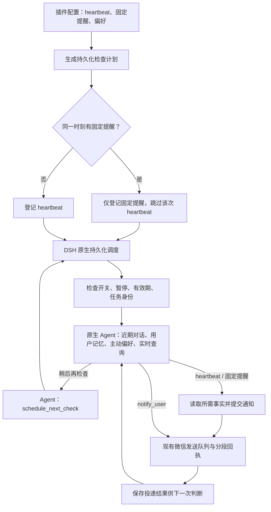

# 主动消息（开发分支）

Telos 复用 DSH 原生 Agent、会话历史、用户记忆和定时任务。这个功能只增加主动联系配置、检查记录和显式通知工具，不运行第二套模型循环。



## 单策略模块版（policy.1）

主动消息分为三层：核心负责定时唤醒、会话与通知队列；策略负责本次联系的业务目的、提示词和发送前校验；工具负责提供事实。`activity_history` 独立于主动策略，停用督促策略后仍可用于普通聊天。没有第二套 Agent 循环，也不新增持久化诊断状态表。

第一版只允许一个策略生效。内置 `goal_execution`（目标执行督促）和 `basic`（基础按需联系，用于切换验证）；不支持同时叠加策略、动态安装第三方代码或策略市场。旧配置自动迁移到已启用的目标执行督促，默认 heartbeat 仍每次发送，原通知时间不变。

- Python `proactive_policies/`：配置校验与旧配置迁移、当前策略上下文、检查目的、`notification_required`。调度层只调用注册表接口，不导入目标诊断规则。
- JavaScript `plugin/proactive-policy.mjs`：每个 Agent 一个策略槽位，延迟加载所选模块。接口为 `bind`、`execute`、`beforeNotify`、`allowsRestrictedRead`、`context`、`reset`。策略没有定时器、接收人或通知队列访问权。
- `plugin/proactive-policies/goal-execution/`：导师提示词、目标/行动/日历校验、行为校验、诊断标签校验一起封装。检查完成是代码记录的临时状态；plan_missing / execution_gap / on_track / unknown 是模型依据事实输出的诊断，不是跨轮状态机。
- `plugin/proactive-capabilities.mjs`：核心的后台只读权限上限。策略不能越过暂停、有效期、用户输入优先、接收人绑定或写入限制。

配置存放在 `proactive.policy`：

```json
{
  "enabled": true,
  "id": "goal_execution",
  "configs": {
    "goal_execution": {
      "goal_list_ids": ["真实目标清单ID"],
      "action_list_ids": [],
      "notification_mode": "always"
    },
    "basic": {"notification_mode": "on_demand"}
  }
}
```

校验时自动补齐策略默认提示词。`configs` 保留未选中策略的设置以便切回，但只有当前启用策略进入模型上下文。目标策略的 `heartbeat_prompt`、`fixed_prompts` 随策略启停；明确自定义的独立固定提醒保留自己的目的。旧版标准目标督促固定提示词迁入策略，核心固定提示词改为通用目的。

在插件「主动消息」中选择策略、启用或停用，并保存应用。停用会卸下当前诊断提示词、取数校验和标签要求，heartbeat 仍按原时间唤醒，默认允许无事静默；固定提醒仍按明确目的执行。切换回目标督促时必须重新查询，旧轮次或已取消的查询不能复用。`basic` 默认按需联系，适合验证没有督促依赖时核心流程仍可工作。

只改策略配置会保留已计划 heartbeat / 固定提醒的 ID、调度修订和时间；取消旧策略正在执行、排队待发送的检查及待执行 followup，防止旧策略内容继续发送。已投递的消息不撤回。调整时间、接收会话或核心提示词等调度配置仍按原规则重建计划。旧版配置的等价迁移只规范化配置缓存，不重建任务。

当前提示词通过可替换状态节点注入；历史对话不删除，核心明确要求只应用当前策略。停用后的代码校验确实卸载，但无法保证模型永不受历史措辞影响。目标策略仍要求本轮实际查询并在后续模型步骤看到结果；仅提供合法诊断标签不能绕过查询。工具不存在或读取失败按原规则允许 `unknown` 降级。

以下章节中“必须行为查询”“导师诊断”等业务规则均仅在目标执行督促启用时适用。旧模块路径保留兼容导出，实际实现位于策略目录。

## 使用与默认值

在插件「主动消息」中选择已经聊过的微信会话，开启总开关后保存并应用。升级后默认关闭总开关，避免自动向未选择的会话发消息。

- heartbeat 默认每 30 分钟检查一次，时间段为 08:00–次日 01:00，时区 Asia/Shanghai。开始时刻包含、结束时刻不包含；开始和结束相同表示全天。间隔从每日开始时刻对齐，而不是从进程启动时刻计时。
- 固定提醒预置 00:00、08:00、12:00、18:00，各自默认关闭；可修改时间、星期和 prompt，添加或删除提醒。
- 00:00 默认轻量回顾刚过去一天的习惯；08:00 对照月目标和当天安排帮助启动；12:00 跟进上午约定；18:00 对照目标与实际进展。读取失败或数据未同步时明确未知，不能编造。
- 有效 heartbeat 和固定提醒要求读取所需事实并调用 notify_user 一次；无新变化或读取失败也简短如实说明。后续检查按各自 prompt 的条件执行。无每日随机次数配额，不补发已失效检查。普通后台文字仍不自动转发；模型未调用工具时如实记录未通知，提示词要求不等于程序强制投递。
- 所有主动消息发送前必须完成本轮 `activity_history` 查询；查询失败允许说明不确定性后降级发送。查询前置条件不改变通知节奏、heartbeat/固定提醒的必发要求或后续检查的条件。
- 同一计划时间、同一会话的启用固定提醒覆盖 heartbeat。判断依据是计划时间，不依赖定时器回调顺序。不合并相近的检查；后续检查与固定提醒同时到期时仍各自执行。
- 「暂停主动消息」覆盖 heartbeat、固定提醒与后续检查，不停止普通聊天或普通 `schedule_create` 任务。支持在微信请求暂停到带时区的指定时间。暂停期间到期的检查取消；恢复从下一时刻继续，不补发被取消的检查。
- 查看待执行和近期结果；后续检查可单独取消。修改调度配置会作废旧计划及旧的后续检查；只修改策略按上节规则处理。只改人设、模型等其他配置不会重建主动消息计划。

## 工具与上下文

### 直接诊断版（diagnosis.1）

当前规则优先诊断缺乏计划（plan_missing），有明确计划后再判断缺乏执行（execution_gap），没有明显问题则具体肯定（on_track）；证据不足用 unknown。只输出一个主要问题和明确提醒，不做人格评价，不构建新的辅导状态机。仍保留 heartbeat / 固定提醒必发、followup 原条件、习惯边界及原通知节奏。

除 activity_history 外，notify_user 还必须通过本轮目标、行动提醒事项、完整本地当日日历的查询校验。`proactive.policy.configs.goal_execution.goal_list_ids` 指定真实目标清单，`action_list_ids` 为空表示全部当前可读提醒事项清单（不扩大 Apple 权限范围）；目标来源未配置或已缺失时只能 unknown。配置变更按原配置保存规则生效。可信上下文 `policy.context.query_requirements` 提供来源和带时区的当日日界（支持夏令时）。

`plugin/proactive-plan.mjs` 包装真实 personalPlan 执行，检查 action、kind、清单及日程范围。提醒事项要求 include_completed=true，不按日期/文字/标签缩窄，涵盖逾期、无日期及已完成事项及备注；一次完整的全清单查询可同时满足目标和行动。只查目标、detail、窄时段日历不能替代完整计划。按 total/offset 合并同范围分页；漏页则拒绝发送。真实工具失败允许未知降级，未查询、在途、已取消、其他轮查询、同批预写通知均不能放行。下一模型步骤收到结果后才允许发送；人类输入、轮次结束或配置范围变化使临时记录失效。

notify_user 的 assessment 是可选策略元数据；目标执行督促要求填写且校验四种取值，仅留在原生工具日志，微信只收到 message；不新增业务数据库列，不将上次诊断固化成后续状态。代码保证最低取数覆盖，不保证模型对目标关联、线下行为或执行偏差的语义判断必然正确。分页不是原子快照，来源变化时应保留不确定性。

以下 mentor.1 / activity-check.1 章节保留此前版本设计和验证记录；直接诊断版的取数和表达规则以上述内容为准。

### 轻量导师模式（mentor.1）

只在 Telos 增加通用导师规则（`plugin/mentor.mjs`），不新增个人背景存储、不修改 DSH 或习惯插件。月目标、行动约定及其背景保存在 Apple 提醒事项和备注中；每次需要判断进展时通过现有 `personalPlan(query/detail)` 读取最新状态。明确区分用户报告、完成记录、日历计划和应用使用证据。已完成/删除的事项停止追问，过时约定不机械补催；新建、修改、完成事项仍遵守普通聊天的 Apple 写入流程。

### 行为对照过渡版（activity-check.1）

每轮主动检查读取最新目标、当天行动/日历及相关备注，调用 `activity_history` 获取实际行为，再分别判断与当日计划的一致性和对目标的支持程度。判断仍由 Agent 完成，不存储匹配分数、不自动调整目标或计划。目标或计划不可读时明确未知；休息、线下行为、缺少记录不能自动视为偏离。

默认 `timeline` 已含统计，不必重复查 `summary`。heartbeat 查看最近 60 分钟；早间/傍晚查看今日零点至今；午间查看今天上午；零点查看刚过去一天；followup 查看约定执行窗口，尚未开始则查看最近 60 分钟。自定义检查由 Agent 按目的选择范围，使用配置时区，按需补查明细/分页。程序验证带时区的有效时间范围和行为来源，不硬编码各类提醒的时间窗口；范围是否与任务相关由提示词约束。

`plugin/proactive-activity.mjs` 只保留当前原生轮次的查询记录（工具调用 ID、视图、范围、结果状态）。真实 `activity_history` 执行返回或抛出错误后才记录，并在下一次模型步骤接收结果后放行；同批调用中的预写通知仍会被拦截。`notify_user` 若尚未满足要求，返回可恢复的 `TELOS_ACTIVITY_REQUIRED`，Agent 补查并读取结果后可继续发送。仅 `status`、仅 `calendar`、缺少时区/无效范围、仍在执行或已取消的查询不能放行；正常成功、部分/缺失数据及读取异常均可完成这一前置条件。失败时内容必须保留未知，不把失败解释为未活动，不循环重试。

同轮工具续接保留记录；检查身份变化、轮次结束、人类输入或重启均要求重新查询，历史结果不用于解锁发送。实现不增加数据库表或持久化事件状态，不改调度、排队、暂停、过期、去重及投递回执。普通聊天不受此限制；Agent 仍须主动调用工具，程序不会自动补发通知或替模型生成降级内容。原始查询与结果由现有宿主工具日志记录，便于试验后检查效果。移除过渡校验时可去掉活动工具的执行包装和 `notify_user` 前置检查，不需迁移业务数据。

验证包含真实隔离宿主中的漏查拦截、仅状态查询拦截、补查成功、部分数据/异常降级、三个主动检查类型、历史结果不能复用及普通聊天；另覆盖同轮续接、在途查询、取消/人类打断、换轮和重启的临时记录清理。测试使用模拟模型、Apple、行为数据和微信。

本版源码验证：23 项主动消息/队列回归、3 项行为前置条件宿主集成、28 项 JavaScript 单元/上下文/UI 测试通过。扩展回归中 `test_native_schedule_crud_and_session_isolation` 在创建第二会话时因 `telosCurrentState` 重复注册失败，已用 2026-11-06 12:02 的改动前模块备份在临时目录复现，非本版引入；未在此实验中修改该模块。本版未替换运行中的插件或验证重新打包的安装归档。

### 既有跟进与习惯边界

导师表达规则：行为查询用于理解用户在推进什么，设备、应用和时长默认留在内部判断；只有内容线索足够时才概括具体活动，不能仅凭应用名称猜用途。活动与目标的关系不清楚且会影响建议时，通过 `notify_user` 问一个具体、开放的问题，问完先等待，不同时判定偏离或安排另一项工作。关系清楚时才给贴近当前任务的一个建议，避免固定时长模板、重复催促、逐轮复述月目标和报告式开场。读取失败只自然说明影响本次判断的不确定性。工具说明和普通输入规则同步采用这一口径，用户明确请求统计时仍可展示数字。

日计划与证据范围：每轮月目标查询之外还需读取当天行动/约定；判断全天或剩余日程时查询本地今日零点至明日零点，不能将行为窗口附带的日程当作完整日计划。没有观察到成果只能视为尚未确认，不能断言没有产出。这些是模型判断与表达规则，不新增状态机或修改通知频率；源码变更不会自动覆盖用户已保存的自定义检查 prompt。

heartbeat 保持 30 分钟默认节奏，帮助启动已认可行动、在约定结束时跟进成果也属于有效联系理由。固定提醒默认改为早间启动、午间跟进、傍晚目标对照、零点轻量习惯收尾。现有自定义 prompt 不自动覆盖；已有用户升级需明确选择应用新偏好。

上下文额外提供最近 8 条已提交的通知（保留 queued/sent/unknown 的真实投递状态）和未来最近 8 条固定/后续检查，避免安静的 heartbeat 淹没上一条通知、或重复登记已有的跟进；没有合并或删除相近检查。个人事实不注入固定 prompt，动态状态仍使用现有可替换节点。

程序依据配置时区与计划时刻，仅为 00:00 的固定提醒标记 `habit_reminder_allowed`；只在该轮放行 `habit_context`、`habit_tasks(list/status)`。后台习惯写入始终禁止，普通用户聊天不受限制。消息语义由导师规则约束，不能把工具权限当作绝对的内容分类器。零点查询必须确认记录覆盖刚过去一天，不把新一天的空白记录当作昨日未完成。屏幕使用只开放现有 MCP 的 `get_summary/get_data_status` 只读接口。

`notify_user({message})` 只能在真实主动检查轮次内调用。会话和检查 ID 由宿主绑定，不允许模型指定收件人。每次检查最多接受一条内容；长消息仍按微信长度限制分段。工具返回 `queued` 只表示入队，实际送达状态来自发送回执。普通后台总结永远不转发，重放完成事件时也一样。

`schedule_next_check({at, reason})` 接收带时区的未来绝对时间和完整检查原因，返回检查 ID。每次调用登记一个独立的持久化检查，不覆盖其他后续检查。相同工具调用 ID 重试返回原记录。原因到期时作为检查 prompt，届时重新读取上下文，而不是预先生成待发消息。此工具不会施加最小时间间隔，也不改变基础 heartbeat 节奏。后续检查和固定提醒可以在 heartbeat 活跃时间段之外运行；Agent 应遵守主动联系偏好中的休息要求。

`proactive_control({action, until?, event_id?})` 支持 list、pause、resume、cancel，仅在人类输入轮次使用。插件页面通过相同业务存储执行这些操作。

每次主动检查注入：检查种类、原计划时间、当前时间、时区、该次 prompt、主动联系偏好、最近检查和投递记录。DSH 继续加载当前会话及 `user.md`，必要时 Agent 使用当前会话历史、Apple、地图与网页查询工具。主动检查限制为只读查询及上述通知/登记工具，不自动执行 Apple 写入、终端或文件修改。用户消息优先，后台输入不能充当人类确认。

## 持久化与恢复

### 漏发后的观察区间恢复（2026-11-09）

独立观察的起点仍为上次成功投递，不随检查失败或渠道拒收推进。当前策略上下文和本轮调度输入提供 `activity_check.next_call`，包含完整区间和待查询来源。活动查询返回 `proactive_observation`，指出短区间查询为何不足；发送校验错误也提供相同的准确补查参数。已完成的来源不要求重复查询，失败来源仍允许如实降级，结果须进入下一步模型后才能发送。普通聊天、基础策略和停用状态不增加此要求。

这不保证外部模型或微信服务始终可用，也不重放过期或结果未知的通知。隔离回归覆盖跨日漏发、从错误参数恢复、两气泡回执、连接失败后的后续检查及重启去重。

### 桌面恢复时的会话归属（2026-11-09）

Telos 在启动完成、接收微信流量之前，恢复已绑定且有持久历史的渠道会话。桌面恢复同一个聊天页时复用已存在的渠道 Agent，不再先创建普通桌面 Agent、随后让微信通道争抢同一个持久会话写锁。没有历史的新会话仍在首条消息时创建，不删除聊天或绕过原生写锁。官方桌面宿主的隔离测试复现旧版“打开页面后微信回复失败”，并验证恢复后的页面与微信使用同一个带渠道工具的 Agent。

### 失败后的队列恢复（queue.1）

`plugin/proactive-queue.mjs` 仅使用宿主公开的 `Agent.inbox`、`steer`、`whenIdle`、状态事件与持久化 flush，不修改 DSH。Agent 空闲后检查队首：只处理能在 Telos 业务存储中核实身份的主动检查；删除已过期、暂停、取消或失效的待处理检查，随后唤醒仍有效的队首。原始检查 ID 和 FIFO 次序保持不变。普通定时任务、其他插件及用户输入不被清理，用户取消/阻塞后不自动重启。

内部空唤醒标记在 pre-step 从模型消息中移除，不调用模型、不进入微信投递。恢复在异步空闲边界进行，不在 `session/event` 回调里重入写入。已消费失败检查不重试，已发送/未知结果不重放。重启时也会检查恢复出来的待处理队列。

验证包含真实宿主循环中的模型服务错误及重试耗尽、过期队首、工具续接时失效、暂停、恢复后的独立通知、重启无重复，以及桌面安装包故障恢复；外部服务均为隔离模拟。

- `proactive.py`：配置校验、计划、暂停、检查身份与生命周期，记录在现有 `business.sqlite`。按未来 26 小时滚动生成固定提醒和 heartbeat；JS 每 30 秒补齐原生任务，这个维护过程不调用模型。
- `plugin/proactive.mjs`：原生调度入口校验、工具、上下文注入。任务 prompt 中只携带内部事件 ID；实际检查原因从业务存储读取。原生创建成功但本地绑定未保存时，从原生任务目录恢复绑定。
- 当前执行的检查在模型输入中同时拥有完整 `event.prompt` 和 `notification_required`。通过准入后，Telos 在原生调度消息中补充本轮指令，保留消息 ID 与 source；不改动普通用户输入或其他任务。系统规则明确通知优先于导师风格中的内容去重，旧静默记录和建议的时间块不能取消当前必发要求。工具续接沿用原生消息历史，不另建模型循环。
- `proactive_channel.py`：本机已认证接口、显式通知入队和静默结束。复用已有当前微信账号/会话校验。
- `scheduled_delivery.py`、`text_delivery.py`：发送前再次检查暂停、配置版本和有效期；保存稳定分段 ID 及回执。已确认片段不重发，明确拒收可重试；超时、取消或崩溃造成发送结果未知时保留记录并停止自动重放。

检查在原计划时刻后 30 分钟过期，避免恢复运行后补发过时的问候。重启可恢复有效期内已登记的任务；从未运行的时间段不追溯补建。DSH 或 Mac 关闭、休眠、断网，以及模型响应耗时，都可能导致延迟。界面显示计划时间，不承诺消息在整点送达。

夏令时按真实时间分钟生成：跳过不存在的本地时间，秋季重复的本地时间分别执行。固定提醒和 heartbeat 在每个真实时间点分别判定冲突。

## 验证

### 可替换的插件状态（2026-11-04，state.1）

`plugin/current-state.mjs` 通过 DSH 已有的 `Session.append`/`surfaceOp.replace` 管理一条 `telos-current-state` 消息，不修改宿主源码或压缩配置。只接管 `telos:business`、`telos:proactive-context`、`habit-coach:current` 三个明确命名的动态贡献。装配后将它们移出自动追加区，在 `agent/request` 阶段（包括溢出重试）提交当前状态。首次调用保留 DSH 的 system 节点零约定；状态不变时不写入新事件。模型请求仍由原生 Agent 构造。

状态消息包含完整当前视图和最多 6,000 字符的变化摘要。摘要只记录选定业务字段（设置、回执、同一习惯的计划/提案/辅导状态）的实际变化；时间采样和选中习惯切换不算计划变更。单条差异会截短，旧摘要超出预算会移出并增加计数；它不是完整审计记录。未决操作、确认及截止时间不通过摘要替代，仍留在当前视图。详细原始消息/工具结果留在 DSH 日志中。本版本不裁剪历史工具返回。

旧快照迁移按结构化 section 名称逐个替换，只保留其他插件的贡献；仅当新固定习惯规则已存在时才移除旧动态 method。无法精确识别的混合内容保守保留。替换引用原事件，原始日志不删除。当前状态及摘要元数据写入同一原生事件，重启或原生压缩后从日志恢复；迁移中断时，从原始 append 记录重建摘要，避免只迁移了一半导致信息丢失。各会话单独管理，不在 `session/event` 回调中重入写入。

验证包括原生 Session 替换/重放、未变化续接、迁移中断、完整原生模型循环的确认/工具续接、进程重启、自动压缩后恢复；也在当前安装的 Desktop rc.3 运行时验证。模拟 Apple、微信和模型测试不访问真实业务数据。

同一真实会话前缀的离线副本：67 份运行快照的文本 252,082 token 被替换为其他模块原文加一条状态消息，共 18,900 token；完整输入估计 345,535 → 112,353（-67.48%，不含消息封装差异）。未移除普通聊天。报告：`reports/current-state-20261104/offline-replay.json`。

官方账号 provider 的 8 次真实缓存调用使用虚构数据：变化后输入 13,368 → 1,614；缓存命中 92.88% → 31.72%，未缓存输入 952 → 1,102。后续状态不变的续接为 13,374 → 1,620，命中 98.58% → 86.91%，未缓存 190 → 212。替换历史会改变缓存前缀，不能把上下文缩减比例当作费用降幅。报告：`reports/current-state-20261104/live-cache.json`。这些不是升级后真实 heartbeat 的计费结果。

### 插件侧上下文精简（2026-11-04）

`plugin/runtime-context.mjs` 只提供模型可见的业务视图，不修改 DSH、会话历史或压缩机制。业务快照不再包含每轮准备时间，确认预览及其过期时间、回执仍完整保留。主动检查视图保留事件类型、到期/失效时间、发送状态、独立 prompt、联系偏好与近期记录，省略内部路由/去重标识及逐次采样的 `now`；完整身份记录仍由执行器用于校验。默认 heartbeat prompt 与偏好相同时只保留偏好一份。JSON 对象键稳定排序。

习惯插件配套改动将完整辅导规则注册为 DSH 固定 system-prompt section，动态区保留计划/提案、问题、阶段、习惯日、能力、目标与未决操作；完整证据和方法通过 `habit_context` 读取。固定规则仍占输入 token，但不再随每次动态状态变化重复追加。

同一份 15:30 历史快照经官方 V4.1 tokenizer 离线估算：动态文本 4,299 → 994 token；其中 2,490 token 的方法原文移动至固定提示，单次两部分合计为 3,484 token。10 次仅时间变化的模拟采样中，动态快照数量从 10 降至 1；包含 running → queued → sent 的采样仍保留 3 份状态。此统计不是线上完整请求计费数据，不清除已有历史，也不承诺整个会话同比下降。明细位于本机 ignored reports/context-optimization-20261104/token-comparison.json。

本轮验证：20 项上下文/主动消息测试通过，57 项扩展聊天/历史/压缩回归通过、1 项跳过；另有一条预览文案断言在优化前的隔离副本中同样失败（无 Apple 写入），未在本任务改动。习惯插件 183 项测试全部通过。

`tests/test_proactive.py` 覆盖时间冲突、关闭固定提醒、跨午夜、时区/夏令时、重复登记、暂停/恢复、会话隔离、过期、真实 DSH 工具调用、静默输出、只读边界、通知回执、重启恢复及相近检查分开执行。模型、Apple 和微信均为本机模拟服务。

`tests/desktop_client.test.mjs` 覆盖插件配置字段、固定提醒 prompt、保存及暂停/取消请求。`tests/test_proactive_hosts.py` 使用编译安装包和隔离 CLI/Desktop 配置，验证保存、运行中控制和通知恢复，不改用户现用安装。

本分支验证：85 项 Python 策略/集成/回归测试与 12 项前端测试通过，包括编译包在隔离 CLI/Desktop 宿主中的配置、暂停/恢复、通知和重启。开发包为 `0.4.20-proactive.1`，未发布、未替换用户现用安装。回归时在原始 main（`8085a95`）复现了一条旧预览文案断言失败，已调整为接受两种合法的拒绝确认提示，同时保留未送达前零写入、后续明确确认仅写入一次的断言。

## 独立行为观察气泡（2026-11-06）

目标执行策略的 `observation_enabled` 开关开启后，每次实际通知必须通过一次 `notify_user` 提交 `observation` 和 `message`；服务端按这个顺序发送两个独立气泡，继续共用同一个通知事件与原有分段回执。观察为事实概括，提醒继续围绕目标、计划/任务和行动。旧配置默认关闭，可在策略设置启用；当前用户的迁移启用此选项。停用策略不会残留其观察要求。

观察区间以同会话上一条完整成功投递的主动通知 `sent_at` 为起点，以本轮首次准入的 `checked_at` 为终点。静默、失败、未知或排队中的通知不重置起点。旧记录没有送达时间时以计划时间近似并标注；没有历史时回顾最近一小时。超过工具31天上限时明确标记截断。该区间在工具续轮中保持稳定，执行层按来源记录本轮已完成且已进入下一步模型的查询：aw、screen_time、health 各自都必须覆盖整个观察区间。省略 sources 默认一次查询三者，也可分开查询。未查询或被取消不能通过；已返回、缺失或查询失败允许说明性降级。完成后自由补查任意来源组合、其他时段或健康详情，不清除已满足的观察条件。未启用独立观察时，至少尝试一种实际行为来源即可；基础/停用策略不施加这些前置条件。

数据库只增加观察文本、实际送达时间和本轮检查时间；不改变定时频率。两个气泡使用同一份持久投递进度，第二个气泡失败重试不会重复第一个。只有完整投递后才更新下一次观察的时间起点。

首气泡登记入现有 outbox 时，用上述 observation_window 添加时间区间标题，连同正文一次保存；重试和重启直接复用已保存内容。分钟级显示不改变查询的精确边界；跨日显示日期，旧记录近似起点及31天截断显式标注。模型只提交正文，必须覆盖整个区间，不能用最近半小时替代。正文优先采用 activity_evidence 的标题描述可识别活动，无标题或泛标题才退回应用/未命名文档层级；仅打开文档不证明写作或完成。第二气泡同样不能把应用使用当作目标进展。本次修改不增加数据库字段、调度状态或投递状态。

微信投递诊断复用传输层事件和 JSON 轮转日志，路径为 `$TELOS_HOME/logs/wechat-delivery.jsonl`（2 MiB × 当前文件及3份备份，文件0600）。记录 HTTP 状态、原始 ret/errcode/errmsg、事件编号、气泡序号、客户端编号及回复上下文指纹；不记录正文、凭据或原始回复上下文。入站上下文指纹也进入同一日志，用于核对刷新前后的差异。未返回的错误码保留 null，不补写为0。

文本遇到明确的 `ret/errcode=-2, errmsg=prepare failed` 且附带回复上下文时，复用已有一次无上下文重试，沿用相同 client_id；网络超时不触发这个重试。只有无上下文重试成功才清理旧上下文，且不覆盖并发收到的新上下文。无上下文仍拒收不证明本地发送成功，也不证明固定限流规则；服务端可能要求新的用户入站消息。原 outbox 保留进度，下一次只续发失败段。定时投递沿用本次 drain 的 blocked 集合，拒收后等待10秒再检查，否则保持2秒；不新增计数器、状态或数据库字段。有效期、取消和暂停规则照常生效，不因补发延长提醒有效期。

第二气泡可复用观察证据或自由补查，时间和来源由 Agent 按目标/计划选择。若评价其他计划时段，必须核对该时段的证据，不从最近短时段推断更早计划未完成；此语义要求由提示词约束，代码不验证自然语言结论。

健康记录仅作为行为背景。睡眠在早间首条或临睡前且相关时才可提；训练通常仅在结束后一小时内且相关时提。参考近期 observation/message 去重，不强行评价健康是否达标，不把日程地点或过去GPS当当前所在地。

桌面启动时，Telos 的异步初始化必须参与宿主 readiness 屏障；不能放在 `appReady.onReady` 回调里，因为回调并不阻止桌面恢复页面。依赖注入等待原生服务，再完成渠道会话恢复后才放行宿主。回归测试在宿主发布地址后立即恢复页面，并模拟较慢历史读取：仅预加载会话的旧修复仍会被页面抢占，加入 readiness 屏障后页面与微信共用渠道实例。
业务桥接服务需由已完成加载的子插件发布，再加载依赖它的微信插件。若在仍处于 loading 的 runtime 插件直接 provide，子插件会等待父插件成为 active；await 子插件返回的可能是依赖等待状态，不能据此报告通道已经启动。
